# Cadastro Fiscal de Clientes e Fornecedores — Guia do Usuário

> Versão documentada: 2.0.0 — 2026-10-07

## 1. Objetivo

O **Cadastro Fiscal de Clientes e Fornecedores** é uma solução da DOME para o NetSuite que valida e completa os dados fiscais dos cadastros de Cliente e Fornecedor, para que estejam sempre corretos e sem duplicidade, independente do país da entidade. Com ela, o sistema:

- Valida automaticamente o formato do Cadastro Federal (CNPJ/CPF) e do Registro Fiscal Internacional.
- Impede que dois cadastros diferentes usem o mesmo Cadastro Federal ou Registro Fiscal Internacional.
- Mostra o campo correto (Cadastro Federal ou Registro Fiscal Internacional) e o exige como obrigatório, de acordo com o País informado.
- Busca automaticamente os dados cadastrais de empresas brasileiras pelo CNPJ (razão social, nome fantasia, telefone, e-mail, endereço, regime tributário e, opcionalmente, Inscrição Estadual) e preenche os campos que ainda estiverem vazios — sem sobrescrever o que já foi preenchido manualmente, com exceção da Razão Social, que é sempre atualizada com o retorno da Receita.
- Opcionalmente, busca o nome de pessoas físicas pelo CPF.
- Controla o consumo de créditos do serviço pago de consulta (Hub do Desenvolvedor) e envia, se desejado, um relatório periódico por e-mail.

A consulta de CNPJ usa dois serviços: o **ReceitaWS** (gratuito, com limite de consultas por minuto) e, quando ele não responde ou atinge o limite, a **Hub do Desenvolvedor** (paga por créditos). A Inscrição Estadual e o CPF são consultados só na Hub do Desenvolvedor.

Cada verificação e cada consulta pode ser ligada ou desligada individualmente, por conta, nas telas de configuração descritas na próxima seção.

## 2. Configuração

Configuração feita uma vez por ambiente, geralmente pelo administrador do sistema, logo após a instalação. As três etapas abaixo são **obrigatórias** — sem elas a solução não opera.

### 2.1 Criar o registro "Configuração das APIs"

Este registro define quais serviços de consulta são usados e com quais credenciais.

1. Acesse **Personalização > Listas, Registros > PD | PETR | Configuração das APIs** e clique em **Novo**. Só deve existir **um** registro ativo por conta.

   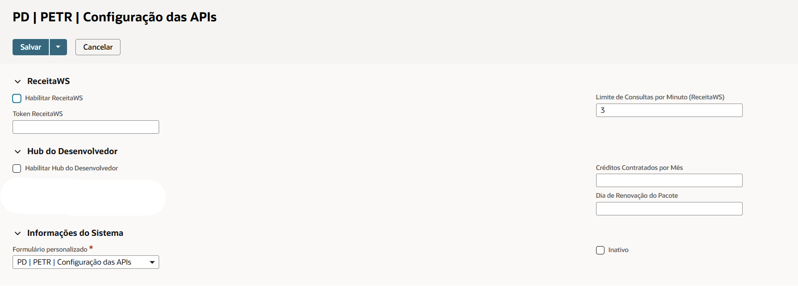
2. No grupo **ReceitaWS**, marque **Habilitar ReceitaWS**. O ReceitaWS é um serviço gratuito e é a primeira opção na consulta de CNPJ — usá-lo economiza créditos da Hub. O **Token ReceitaWS** é opcional — preencha só se houver plano pago contratado no ReceitaWS e, nesse caso, aumente também o **Limite de Consultas por Minuto (ReceitaWS)** conforme o plano (o padrão, 3, é o limite do serviço gratuito).

   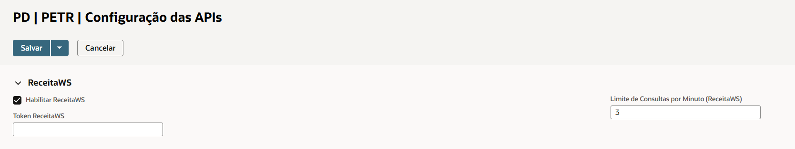
3. No grupo **Hub do Desenvolvedor**, marque **Habilitar Hub do Desenvolvedor**. A Hub é o serviço pago por créditos que responde quando o ReceitaWS não responde ou atinge o limite por minuto, e é a única que traz a Inscrição Estadual e consulta CPF. Informe também **Créditos Contratados por Mês** (quantidade do pacote contratado) e **Dia de Renovação do Pacote** (de 1 a 28): com eles, o relatório de créditos calcula o saldo do pacote e avisa quando o consumo passa do contratado. Sem eles, o consumo continua sendo registrado, mas o relatório não mostra saldo.

   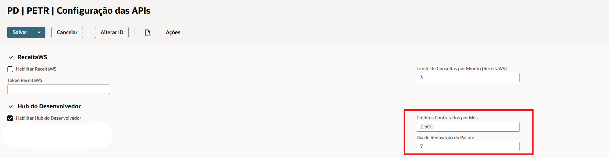
4. Salve o registro.

### 2.2 Criar o registro "Configuração das Validações"

Este registro é o que liga as validações. **Enquanto ele não existir, nenhuma validação e nenhuma busca automática de dados é executada** — os cadastros continuam podendo ser salvos, mas sem nenhuma verificação.

1. Acesse **Personalização > Listas, Registros > PD | PETR | Configuração das Validações**.
2. Clique em **Novo** para criar o registro. Só deve existir **um** registro ativo por conta.
3. Marque as verificações que deseja ativar. Os campos vêm organizados nos grupos "Validação de Duplicidade", "Consulta na Receita", "Atualização de Campos via Receita" e "Relatório de Créditos da Hub", e cada um tem um texto de ajuda explicando o efeito.

   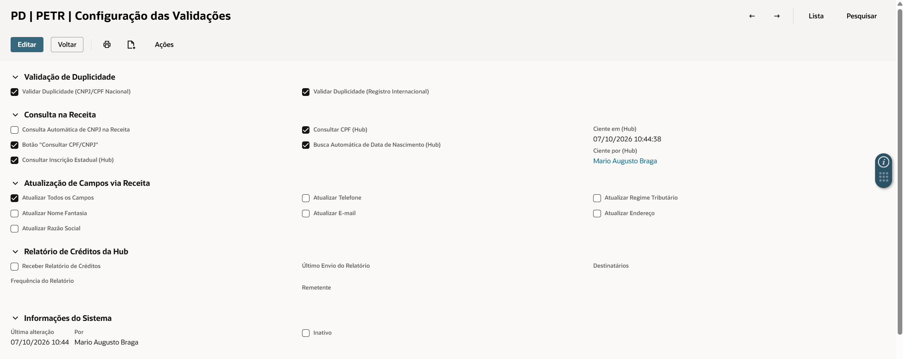
4. Se quiser que **todos** os campos sejam atualizados automaticamente pela Receita, marque **Atualizar Todos os Campos** — é o atalho para manter o cadastro completo sem escolher campo a campo. Ao marcar, os seis campos individuais abaixo são desmarcados e ficam bloqueados — desmarcando novamente, eles voltam como estavam.

   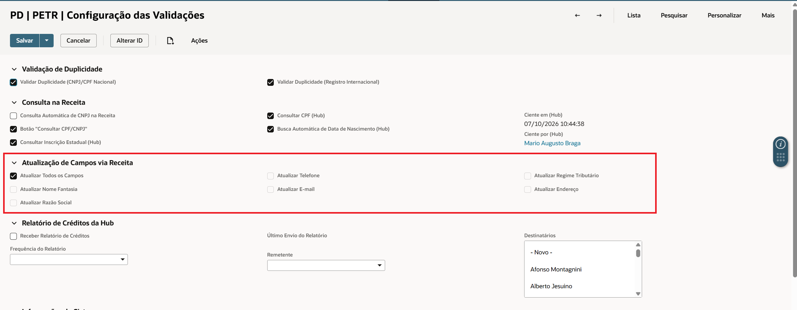
5. No grupo **Consulta na Receita**, marque **Consultar Inscrição Estadual (Hub)** para que a Inscrição Estadual do cadastro seja preenchida automaticamente, sem digitação. Ela vem na mesma consulta de CNPJ pela Hub, sem créditos adicionais — e por isso só é preenchida quando a consulta é respondida pela Hub, já que o ReceitaWS não retorna Inscrição Estadual.
6. Ainda em **Consulta na Receita**, marque **Consultar CPF (Hub)** para que o nome de pessoas físicas seja preenchido a partir do CPF. Desmarcado, o CPF continua sendo validado (formato e duplicidade), mas não é consultado. Só com ele marcado o campo **Busca Automática de Data de Nascimento (Hub)** fica disponível.

   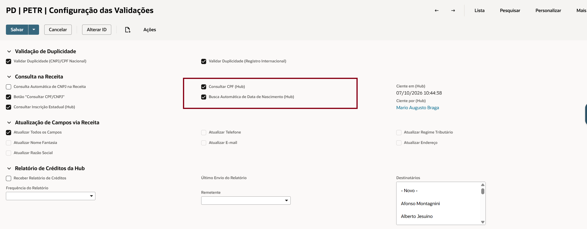
7. **Por que a Data de Nascimento é necessária:** quando o CPF não está na base da Hub, a consulta é feita direto na Receita Federal, e a Receita só libera os dados de um CPF quando recebe junto a data de nascimento do titular. Os cadastros de Cliente e Fornecedor têm o campo **Data de Nascimento**: se ele for preenchido manualmente, a consulta usa essa data direto e não precisa da busca automática (5 créditos em vez de 15). Se o campo estiver vazio, a **Busca Automática de Data de Nascimento (Hub)** obtém a data em uma base de terceiros (10 créditos) e, com ela, faz a consulta na Receita (5 créditos). Se marcar essa opção, aparece o aviso **"Aviso de cobrança adicional"**: cada CPF fora da base da Hub e sem Data de Nascimento no cadastro pode consumir até 15 créditos, e o excedente ao pacote contratado pode ser cobrado pela Hub. Clique em **Estou ciente** para manter a opção, ou em **Cancelar** para desmarcá-la.

   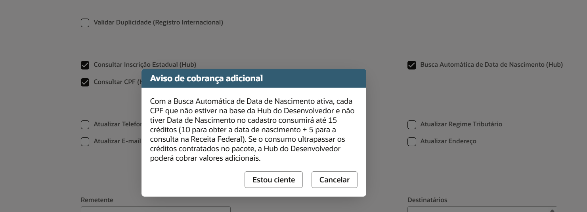
8. No grupo **Relatório de Créditos da Hub**, configure o e-mail que acompanha o consumo do pacote da Hub. Ele mostra quantos créditos já foram usados no ciclo, quanto resta e se o consumo passou do contratado — assim dá para agir antes de haver cobrança adicional, sem precisar abrir o NetSuite. Marque **Receber Relatório de Créditos**, escolha a **Frequência do Relatório** (Diário, Semanal ou Mensal), o **Remetente** e os **Destinatários** (funcionários; o e-mail do cadastro de cada um é usado).

   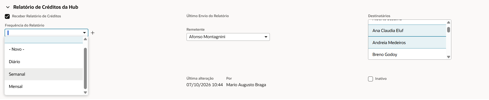
9. Salve o registro. Se a busca automática de data de nascimento foi marcada, os campos **Ciente em (Hub)** e **Ciente por (Hub)** passam a mostrar a data/hora e o usuário que deu a ciência — é o registro de quem aceitou o aviso de cobrança adicional.

   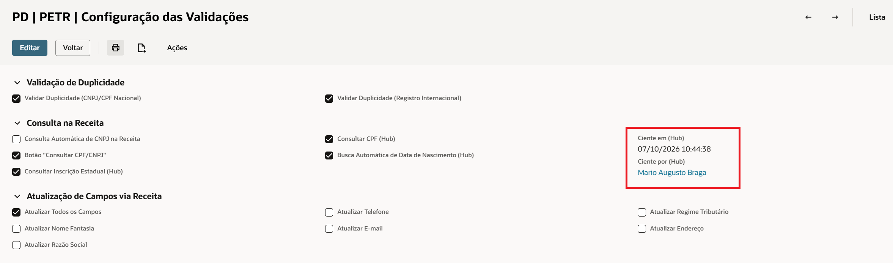

A configuração é lida uma vez a cada carregamento de tela. Alterações feitas aqui passam a valer no próximo cadastro aberto.

### 2.3 Informar o país "Brasil" da conta

1. Acesse **Configuração > Empresa > Preferências Gerais**.
2. Clique na subaba **Preferências Personalizadas**.
3. Na seção **"PD | Entity Tax Registration"**, selecione **Brasil** no campo **Brasil Country Internal ID**.

   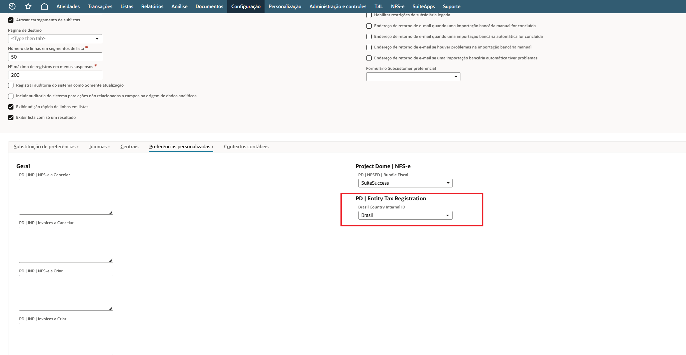
4. Salve a página.

Sem esse campo preenchido, o sistema não consegue identificar quando uma entidade é brasileira, e a validação de CNPJ/CPF e a busca automática de dados ficam desativadas.

### Papéis de acesso

Nesta versão, as telas de configuração, o registro de consumo de créditos e a solução nos cadastros estão liberados para **todos os papéis** — não há restrição por perfil.

## 3. Utilização

Aplica-se aos cadastros de **Cliente** e **Fornecedor**.

1. Abra um cadastro de Cliente ou Fornecedor (novo ou existente) e selecione o **País**.

   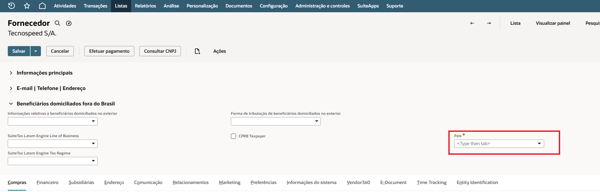
2. Ao selecionar o País, o sistema habilita automaticamente o campo correto:
   - País = **Brasil** → **Cadastro Federal** fica habilitado e obrigatório; **Registro Fiscal Internacional** fica desabilitado.
   - Qualquer outro país → o inverso.
3. **Se País = Brasil:** preencha o **Cadastro Federal** com o CNPJ ou CPF da entidade. O formato e a duplicidade são validados ao sair do campo.

   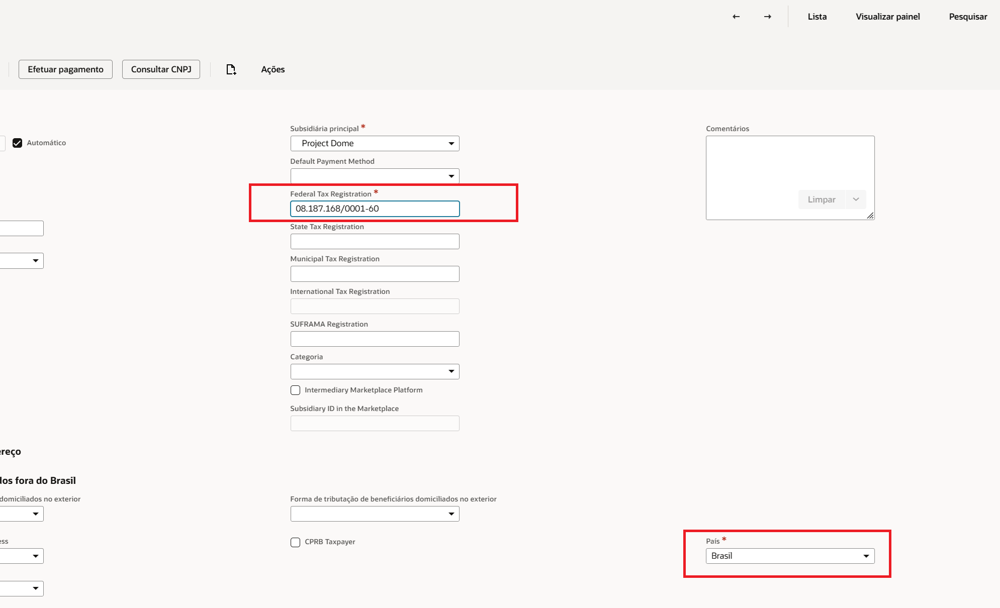
4. Para trazer os dados **antes** de salvar, use o botão de consulta — ele se chama **"Consultar CNPJ"**, ou **"Consultar CPF/CNPJ"** quando a consulta de CPF está habilitada. Funciona nos modos de **criação, edição e visualização** — em visualização, a página é recarregada ao final para exibir os dados atualizados. Durante a consulta aparece a mensagem **"Aguarde! Consultando dados do CPF/CNPJ..."**, que fica na tela até a resposta chegar.

   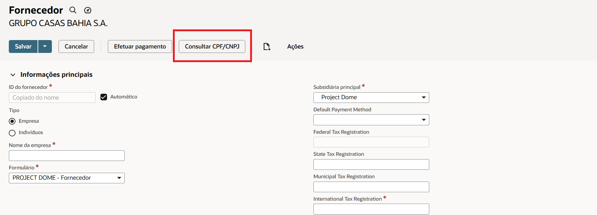

   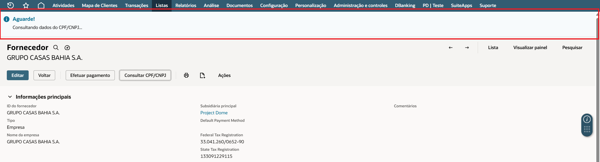
5. **Para pessoa física (CPF):** o nome retornado é gravado no campo de nome da pessoa — o cadastro precisa estar marcado como pessoa física (Individual). Se o CPF não estiver na base da Hub, a consulta precisa da **Data de Nascimento** do cadastro: preencha-a antes de consultar, ou peça ao administrador para ativar a busca automática de data de nascimento (seção 2.2, passo 7). Quando a data vier da consulta, ela é gravada no cadastro se o campo estiver vazio.

   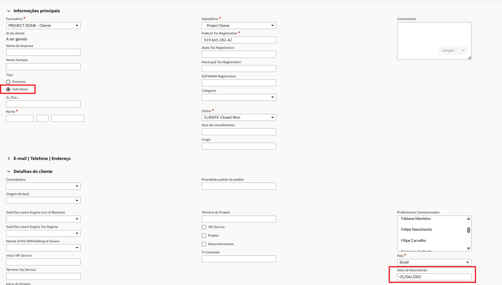
6. **Se o País não for Brasil:** preencha o **Registro Fiscal Internacional** com o identificador fiscal da entidade no país de origem. Não há busca automática de dados nesse caso.

   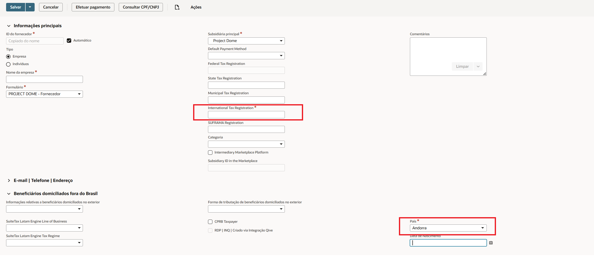
7. **Salve o cadastro.** No salvamento, o sistema faz as últimas verificações para que o cadastro fique correto e completo:
   - **Confere de novo a duplicidade** do Cadastro Federal ou do Registro Fiscal Internacional — por exemplo, se outro usuário cadastrou o mesmo documento enquanto este estava aberto.
   - **Busca os dados na Receita**, se a **Consulta Automática de CPF/CNPJ** estiver marcada, e preenche razão social, nome fantasia, telefone, e-mail, endereço, regime tributário e Inscrição Estadual — **somente os campos vazios e somente os que estiverem marcados na configuração**. A exceção é a **Razão Social, que é sempre atualizada** com o retorno da Receita. Se os dados já foram trazidos pelo botão de consulta, a busca não é repetida.
   - **Para CPF**, a busca no salvamento precisa de **Consulta Automática de CPF/CNPJ** e **Consultar CPF (Hub)** marcados. Se o CPF não estiver na base da Hub, precisa também da **Data de Nascimento** preenchida no cadastro ou da **Busca Automática de Data de Nascimento (Hub)** marcada — sem nenhuma das duas, a busca não é feita e aparece o aviso "Data de Nascimento necessária".

### 3.1 Acompanhar o consumo de créditos

Cada consulta que consome créditos da Hub do Desenvolvedor gera automaticamente um registro de consumo, que permite conferir em que, quando e por quem os créditos foram gastos.

1. Acesse **Personalização > Listas, Registros > PD | PETR | Consumo de Créditos da Hub** para ver as consultas, com tipo de consulta, CPF/CNPJ consultado, créditos consumidos, usuário e data.

   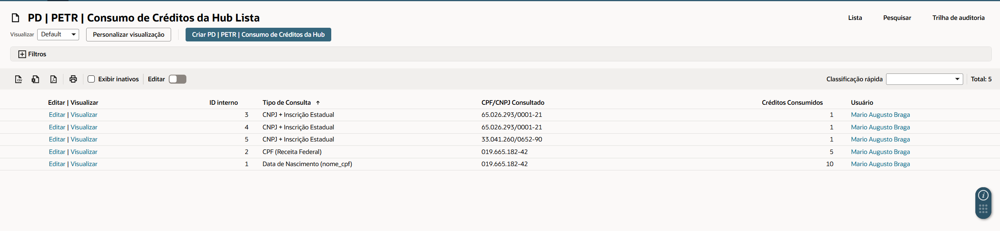
2. Se o relatório estiver ligado (seção 2.2, passo 8), os destinatários recebem por e-mail, na frequência escolhida, o consumo do ciclo atual do pacote: créditos contratados, consumidos, saldo, percentual utilizado e o consumo por tipo de consulta. Quando o consumo passa do contratado, o e-mail destaca o excedente.

   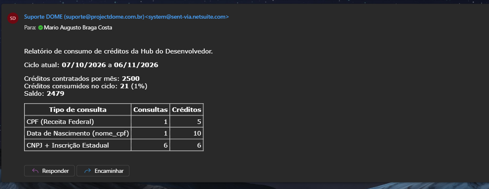

Ultrapassar os créditos contratados **não bloqueia** as consultas — a Hub do Desenvolvedor pode cobrar o excedente.

## 4. Campos e parâmetros

### 4.1 Campos do cadastro

| Campo (rótulo na tela) | Onde aparece | O que significa | Obrigatório? | Valores aceitos / exemplo |
|---|---|---|---|---|
| País | Formulário de Cliente/Fornecedor | Define qual dos dois campos abaixo fica habilitado e obrigatório. | Sim | Qualquer país da lista padrão do NetSuite. |
| Cadastro Federal | Mesmo formulário, próximo a País | CNPJ (pessoa jurídica) ou CPF (pessoa física) da entidade brasileira. Usado para validar duplicidade e buscar dados cadastrais. | Sim, quando País = Brasil | CNPJ: 14 caracteres (aceita o novo formato alfanumérico da Receita Federal) — ex. `11.222.333/0001-81`. CPF: 11 dígitos. |
| Registro Fiscal Internacional | Mesmo formulário | Identificador fiscal da entidade em países que não usam CNPJ/CPF. Usado para validar duplicidade. | Sim, quando País ≠ Brasil | Texto livre, deve ser único entre os cadastros. |
| Data de Nascimento | Mesmo formulário | Data de nascimento da pessoa física. Necessária para consultar na Receita um CPF que não está na base da Hub; preenchida automaticamente quando a consulta a retorna. | Não | Data. |
| Inscrição Estadual | Mesmo formulário | Preenchida pela consulta de CNPJ quando "Consultar Inscrição Estadual (Hub)" está marcado e o campo está vazio. | — | — |
| Botão "Consultar CNPJ" / "Consultar CPF/CNPJ" | Barra de botões do formulário | Dispara a consulta na hora, sem esperar o salvamento. Disponível em criação, edição e visualização. | — | — |

### 4.2 Configuração das Validações (ver seção 2.2)

| Campo (rótulo na tela) | Grupo | O que significa |
|---|---|---|
| Validar Duplicidade (CNPJ/CPF Nacional) | Validação de Duplicidade | Verifica se o CNPJ/CPF informado já está cadastrado em outra entidade antes de salvar. |
| Validar Duplicidade (Registro Internacional) | Validação de Duplicidade | Verifica se o Registro Fiscal Internacional já está cadastrado em outra entidade antes de salvar. |
| Consulta Automática de CPF/CNPJ | Consulta na Receita | Consulta automaticamente ao salvar um cadastro (criação ou edição) com documento válido, sem precisar clicar no botão. Para CPF, exige também "Consultar CPF (Hub)" marcado. Vale também para importação por planilha. |
| Botão "Consultar CPF/CNPJ" | Consulta na Receita | Exibe o botão de consulta manual no formulário de Cliente/Fornecedor. |
| Consultar Inscrição Estadual (Hub) | Consulta na Receita | Inclui a Inscrição Estadual na consulta de CNPJ pela Hub, sem créditos adicionais. |
| Consultar CPF (Hub) | Consulta na Receita | Permite consultar pessoas físicas pelo CPF na Hub e muda o nome do botão para "Consultar CPF/CNPJ". Desmarcado, o CPF continua sendo validado, mas não é consultado. |
| Busca Automática de Data de Nascimento (Hub) | Consulta na Receita | Para CPF fora da base da Hub e sem Data de Nascimento no cadastro, busca a data automaticamente (até 15 créditos por CPF). Exige "Consultar CPF (Hub)" marcado e a confirmação do aviso de cobrança. Não é ligada por "Atualizar Todos os Campos". |
| Ciente em (Hub) | Consulta na Receita | Data e hora em que a busca automática foi marcada pela última vez. Preenchido automaticamente. |
| Ciente por (Hub) | Consulta na Receita | Usuário que marcou a busca automática pela última vez. Preenchido automaticamente. |
| Atualizar Nome Fantasia | Atualização de Campos via Receita | Preenche o Nome Fantasia com o retorno da Receita, se estiver vazio. |
| Atualizar Razão Social | Atualização de Campos via Receita | Preenche a Razão Social com o retorno da Receita — **sempre**, mesmo que já exista um valor preenchido. |
| Atualizar Telefone | Atualização de Campos via Receita | Preenche o Telefone, se estiver vazio. |
| Atualizar E-mail | Atualização de Campos via Receita | Preenche o E-mail, se estiver vazio. |
| Atualizar Regime Tributário | Atualização de Campos via Receita | Preenche o Regime Tributário a partir do retorno da Receita, se estiver vazio. |
| Atualizar Endereço | Atualização de Campos via Receita | Preenche o endereço a partir do retorno da Receita/CEP; uma linha nova só é acrescentada se o CEP ainda não existir no cadastro. |
| Atualizar Todos os Campos | Atualização de Campos via Receita | Liga a atualização de todos os campos acima de uma vez e desabilita a seleção individual. |
| Receber Relatório de Créditos | Relatório de Créditos da Hub | Liga o envio periódico do relatório de créditos por e-mail. |
| Frequência do Relatório | Relatório de Créditos da Hub | Diário, Semanal (7 dias após o último envio) ou Mensal (1 mês após o último envio). |
| Último Envio do Relatório | Relatório de Créditos da Hub | Data do último envio. Preenchido automaticamente. |
| Remetente | Relatório de Créditos da Hub | Funcionário que aparece como remetente do e-mail. |
| Destinatários | Relatório de Créditos da Hub | Funcionários que recebem o e-mail. |

> A validação de **formato** do CNPJ/CPF (dígito verificador) roda sempre e não tem opção de desligar.

### 4.3 Configuração das APIs (ver seção 2.1)

| Campo (rótulo na tela) | Grupo | O que significa |
|---|---|---|
| Habilitar ReceitaWS | ReceitaWS | Usa o ReceitaWS como primeira opção de consulta de CNPJ. |
| Token ReceitaWS | ReceitaWS | Opcional — só para plano pago do ReceitaWS. |
| Limite de Consultas por Minuto (ReceitaWS) | ReceitaWS | Máximo de consultas por minuto ao ReceitaWS (padrão 3). Acima disso, a consulta vai para a Hub do Desenvolvedor, se habilitada. |
| Habilitar Hub do Desenvolvedor | Hub do Desenvolvedor | Usa a Hub quando o ReceitaWS falha ou atinge o limite, e para Inscrição Estadual e CPF. |
| Créditos Contratados por Mês | Hub do Desenvolvedor | Tamanho do pacote mensal, usado para calcular saldo e excedente no relatório. |
| Dia de Renovação do Pacote | Hub do Desenvolvedor | Dia do mês (1 a 28) em que o pacote renova; o ciclo do relatório começa nesse dia. Vazio, o ciclo começa no dia 1. |

### 4.4 Consumo de Créditos da Hub (ver seção 3.1)

| Campo (rótulo na tela) | O que significa |
|---|---|
| Tipo de Consulta | CNPJ, CNPJ + Inscrição Estadual, CPF (base Hub), CPF (Receita Federal) ou Data de Nascimento (nome_cpf). |
| CPF/CNPJ Consultado | Documento consultado. |
| Créditos Consumidos | Créditos cobrados pela Hub nessa consulta. |
| Usuário | Quem fez a consulta (vazio em execuções automáticas sem usuário). |

### 4.5 Parâmetro de ambiente (ver seção 2.3)

| Campo (rótulo na tela) | Onde aparece | O que significa | Obrigatório? |
|---|---|---|---|
| Brasil Country Internal ID | Configuração > Empresa > Preferências Gerais, subaba Preferências Personalizadas | Diz ao sistema qual registro de País representa "Brasil" nesta conta. | Sim, uma vez por ambiente |

## 5. Exemplos de uso

**Cenário 1 — Cadastro de Cliente brasileiro com preenchimento automático:**
1. Cria-se um novo Cliente e seleciona-se País = Brasil.
2. Preenche-se Cadastro Federal com `11.222.333/0001-81` (CNPJ fictício, usado só para ilustrar o fluxo). Ao sair do campo, o sistema valida o formato e confirma que não há outro cadastro com esse CNPJ.
3. Salva-se o cadastro. Nesse momento o sistema busca os dados da empresa — preenchendo apenas os campos vazios cuja atualização está marcada na configuração.

**Cenário 2 — Erro: configuração ainda não criada:**
1. Ao salvar um cadastro, ou ao clicar no botão de consulta, aparece o alerta **"Configuração necessária"**, com a mensagem: *"Não há registro de Configuração das Validações ativo nesta conta. Crie-o para habilitar a validação e a atualização automática dos dados da entidade. Em caso de dúvida, acione a equipe Dome."*
2. **Atenção:** o cadastro ainda é salvo, mas **sem nenhuma validação**. Crie o registro descrito na seção 2.2 antes de usar a solução em produção.

**Cenário 3 — Erro: CNPJ já cadastrado em outra entidade:**
1. Ao preencher o Cadastro Federal com um CNPJ que já existe em outro Cliente ou Fornecedor, o sistema exibe um alerta informando que o CNPJ/CPF já está cadastrado e limpa o campo.
2. Confira se não está duplicando um cadastro existente antes de tentar novamente.

**Cenário 4 — Erro: formato inválido:**
1. Ao preencher o Cadastro Federal com um valor que não corresponde a um CNPJ/CPF válido, o sistema exibe um alerta específico ("CNPJ inválido"/"CPF inválido") e limpa o campo.

**Cenário 5 — Cliente de outro país:**
1. Cria-se um novo Cliente e seleciona-se um País diferente de Brasil.
2. O campo Cadastro Federal fica desabilitado; preenche-se o Registro Fiscal Internacional com o identificador fiscal local. Não há busca automática de dados nesse caso.

**Cenário 6 — CPF sem Data de Nascimento, busca automática desligada:**
1. Num cadastro de pessoa física, preenche-se o Cadastro Federal com um CPF e clica-se em "Consultar CPF/CNPJ".
2. Se o CPF não estiver na base da Hub, aparece o alerta **"Data de Nascimento necessária"**: *"O CPF não está na base da Hub do Desenvolvedor. Para consultá-lo na Receita Federal, preencha o campo Data de Nascimento do cadastro e consulte novamente."* Nenhum crédito é consumido.
3. Preenche-se a Data de Nascimento e consulta-se de novo — o nome é preenchido.

**Cenário 7 — CPF com consulta de CPF desligada:**
1. Ao clicar no botão de consulta com um CPF no Cadastro Federal, aparece o alerta **"Consulta de CPF desabilitada"**, indicando para marcar "Consultar CPF (Hub)" na Configuração das Validações.

**Cenário 8 — Consumo acima do pacote:**
1. O relatório de créditos mostra consumo acima dos Créditos Contratados por Mês, com o aviso de que a Hub do Desenvolvedor poderá cobrar valores adicionais.
2. As consultas continuam funcionando normalmente; para reduzir o consumo, avalie desmarcar "Busca Automática de Data de Nascimento (Hub)".

## 6. Pendências desta versão

### Conferências

- [ ] Conferir se os rótulos citados batem com a tela do ambiente do cliente, em especial o nome do campo Inscrição Estadual (pertence a outro pacote instalado na conta).
